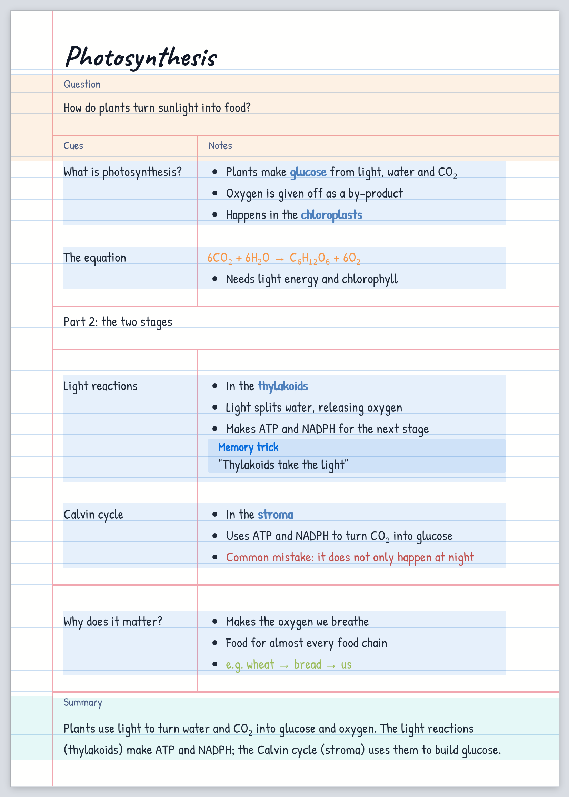
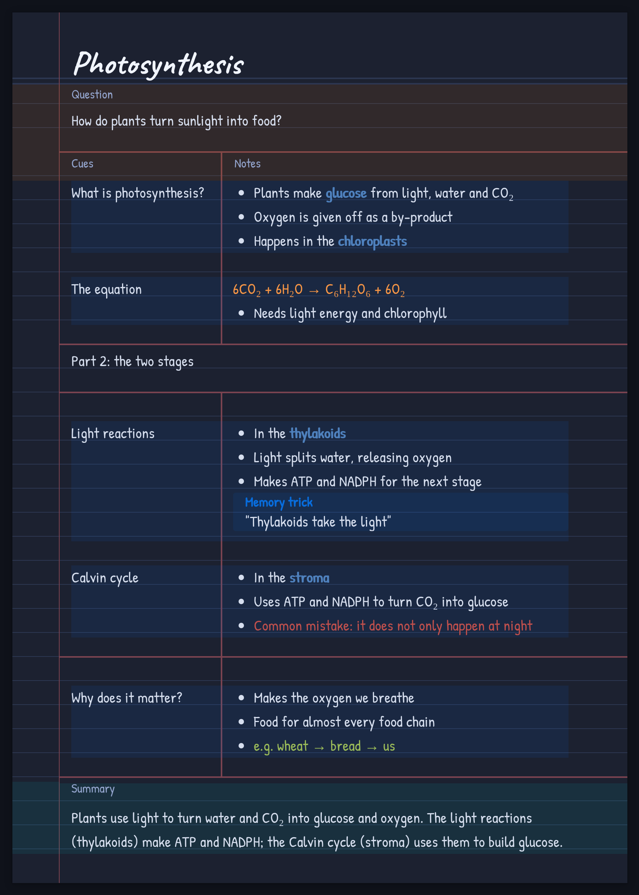
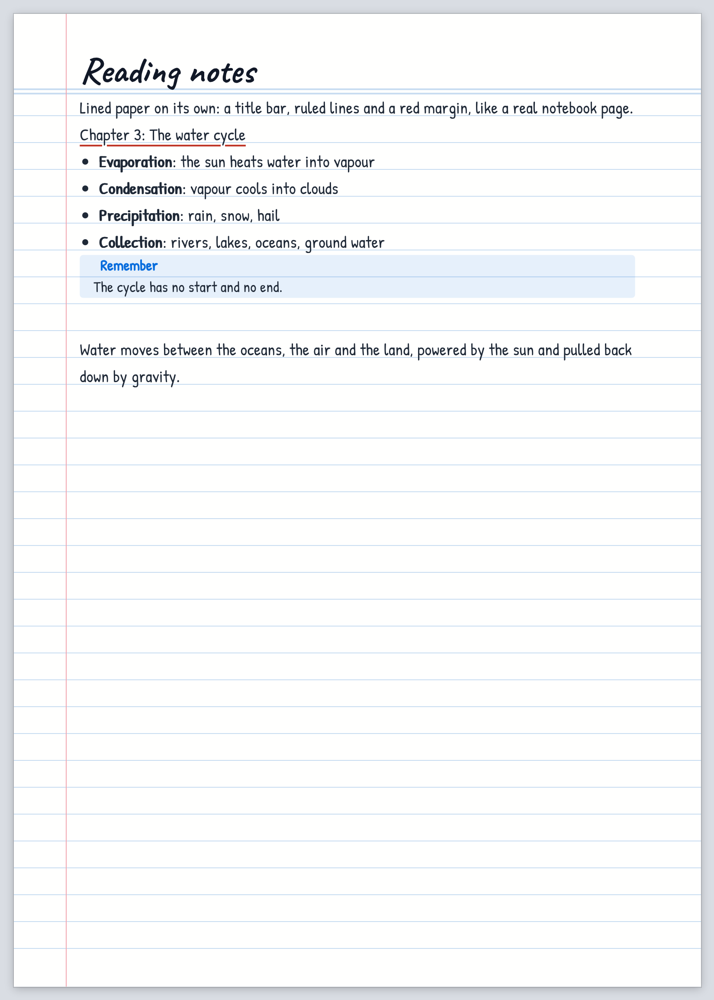

# Lined Paper Pages

**Lined paper and Cornell notes for [Obsidian](https://obsidian.md).** Your notes look like
handwritten pages: ruled lines, a red margin, a title bar, and the Cornell layout (cues, notes,
summary). Reading view shows them as real A4 sheets that look exactly like the PDF export.

<p align="center">
  
  
</p>

## Features

- **Lined paper**: text sits on ruled lines, with a red margin line and a title bar, in reading
  view, editing view and the PDF. Handwriting fonts to choose from.
- **Cornell notes**: an essential question, cue | notes columns, and a summary that always sits on
  the bottom lines of the last page.
- **Real A4 pages in reading view**, page for page and word for word the same as *Export to PDF*.
  Long notes continue on the next page in the right column; nothing ever runs into a footer.
- **Building blocks**: `[!wide]` lines across both columns, `[!divider]` lines, `[!nextpage]` page
  breaks, pictures sized to the rows, and every Obsidian callout fitted to the lines.
- **Embedded callouts** (`![[Note#^id]]`) look exactly like typed ones, and update with their note.
- **Colour coding**: coloured text and links with `<font color>`, in every view.
- **A settings page** for everything (sizes, fonts, colours, Cornell layout), also available in
  the Style Settings plugin.
- **Nothing is ever written into your notes.** Turn it off and your notes are plain Markdown.

## Installation

Lined Paper Pages has two parts that work as a set: the **plugin** and two **CSS snippets**.

1. Download `lined-paper-pages-<version>.zip` from the [latest release](../../releases/latest)
   and unzip it.
2. Copy the `lined-paper-pages` folder into `<your vault>/.obsidian/plugins/`.
3. Copy the two files in `snippets/` into `<your vault>/.obsidian/snippets/`.
4. In Obsidian: *Settings → Community plugins* → switch on **Lined Paper Pages**, and
   *Settings → Appearance → CSS snippets* → switch on **lined-paper** and **cornell-notes**.

To update, replace the plugin folder and both snippets, then restart Obsidian. The version that is
running is shown at the top of *Settings → Lined Paper Pages*.

<details>
<summary>Installing from a copy of this repository</summary>

The plugin needs no build step. Copy `main.js`, `manifest.json` and `styles.css` into
`<your vault>/.obsidian/plugins/lined-paper-pages/`, and `snippets/*.css` into
`<your vault>/.obsidian/snippets/`.
</details>

## Quick start

Add a `cssclasses` property to a note:

```markdown
---
cssclasses: [lined-paper, cornell]
---

# Photosynthesis

> [!question] Question
> How do plants turn sunlight into food?

>> [!cue]
>> What is photosynthesis?
>
>> [!notes]
>> - Plants make **glucose** from light, water and CO₂
>> - Oxygen is given off as a by-product

> [!summary] Summary
> Plants use light to turn water and CO₂ into glucose and oxygen.
```

Use `cssclasses: [lined-paper]` for lined paper without the Cornell layout. Only notes with these
classes are changed. The [examples](examples/) folder has two complete notes to copy.

## Documentation

| | |
|---|---|
| [Writing notes](docs/writing-notes.md) | Every block: question, cues and notes, `[!wide]`, `[!divider]`, `[!nextpage]`, summary, callouts, embeds, colours, pictures, PDF export. |
| [Cornell note guide](docs/cornell-note-guide.md) | A one-page reference with the exact rules, a colour scheme and a complete example. Written so that an AI can follow it too. |
| [Settings](docs/settings.md) | Every option on the settings page. |
| [Troubleshooting](docs/troubleshooting.md) | Common problems, limits, and how to report a bug. |
| [How it works](docs/architecture.md) | For contributors: how the pages are made. |

<p align="center">
  
</p>

## Exporting to PDF

Use *⋯ → Export to PDF* with **Page size: A4** and **Margin: None**. The PDF has the same pages as
reading view; every page repeats the title bar and the Cues | Notes row.

## Privacy and compatibility

- **Network**: the handwriting fonts load from Google Fonts (`fonts.googleapis.com`). Nothing
  else is sent anywhere. Pick a font installed on your computer to use it offline.
- **Obsidian internals**: to keep reading view still while you scroll, the plugin adjusts how
  Obsidian's reading view renders long lined-paper notes. This uses parts of Obsidian that are not
  an official API; if they change, the plugin leaves them alone and only that feature stops.
- Requires Obsidian 1.4 or newer. Developed and tested on desktop; it isn't marked desktop-only,
  but mobile is untested.

## Development

```sh
npm install          # Playwright, CodeMirror and esbuild, for the tests
npx playwright install chromium
npm run lint         # syntax, JSON, version numbers, stylesheet braces
npm test             # the whole test suite in a real Chromium (needs pdftotext: poppler-utils)
npm run package      # dist/lined-paper-pages-<version>.zip
```

The plugin is plain JavaScript with no build step; edit `main.js` and the stylesheets directly.
See [CONTRIBUTING.md](CONTRIBUTING.md) for the project layout, the tests and how to release.

## License

[MIT](LICENSE)
